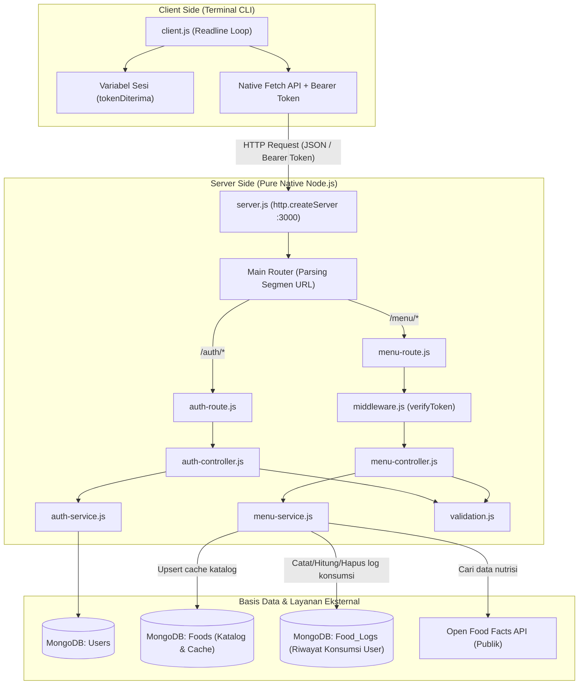

# PANDUAN LENGKAP & STRATEGI PRESENTASI PROYEK NUTRICHECK
**Aplikasi Pelacak Nutrisi & Asupan Harian (Node.js Native REST API & Interactive Terminal CLI)**

---

## DAFTAR ISI
1. [Ringkasan Eksekutif & Arsitektur Sistem](#1-ringkasan-eksekutif--arsitektur-sistem)
2. [Alur Kerja Sistem (End-to-End Workflow)](#2-alur-kerja-sistem-end-to-end-workflow)
3. [Struktur Folder & Penjelasan Detail Setiap File](#3-struktur-folder--penjelasan-detail-setiap-file)
4. [Poin-Poin Kritis yang Wajib Diperhatikan Saat Presentasi](#4-poin-poin-kritis-yang-wajib-diperhatikan-saat-presentasi)
5. [Pembagian Tugas Presentasi Kelompok (5 Anggota)](#5-pembagian-tugas-presentasi-kelompok-5-anggota)
6. [Analisis Evaluasi, Celah Keamanan & Rekomendasi Solusi](#6-analisis-evaluasi-celah-keamanan--rekomendasi-solusi)
7. [Panduan Langkah Live Demo Terminal](#7-panduan-langkah-live-demo-terminal)

---

## 1. Ringkasan Eksekutif & Arsitektur Sistem

### 1.1 Deskripsi Proyek
**NutriCheck** adalah aplikasi pelacak asupan nutrisi makanan harian berbasis arsitektur **Client-Server**. Sistem ini memfasilitasi pengguna untuk mendaftarkan akun, melakukan autentikasi terenkripsi, mencari katalog kandungan gizi makanan global (terintegrasi dengan *Open Food Facts API*), mencatat riwayat konsumsi makanan harian, melihat akumulasi nutrisi harian (kalori, protein, lemak, karbohidrat), serta mengelola atau menghapus riwayat makanan.

### 1.2 Nilai Jual & Keunikan Teknis
* **Pure Native Node.js Server:** Backend dibangun murni menggunakan modul bawaan `http.createServer` **tanpa framework pihak ketiga (seperti Express.js atau Fastify)**. Ini membuktikan penguasaan fundamental protokol HTTP, penanganan stream data (*event-driven buffers*), dan routing manual di Node.js.
* **Separation of Concerns (MVC Pattern):** Kode dipecah rapi menjadi lapisan *Config*, *Route*, *Controller*, *Service*, *Middleware*, *Validation*, dan *Utils*.
* **Stateless Authentication:** Keamanan menggunakan JSON Web Token (JWT) yang dikirim via HTTP header standard `Authorization: Bearer <token>`.
* **Smart Caching & Offline Fallback:** Integrasi API publik Open Food Facts dilengkapi dengan penyimpanan cache lokal otomatis ke MongoDB dan mekanisme *fallback* regex jika koneksi internet terputus.

### 1.3 Tech Stack & Dependensi
* **Runtime:** Node.js (v18+)
* **Database:** MongoDB Atlas (NoSQL) menggunakan official driver `mongodb` (^7.7.0).
* **Autentikasi:** JSON Web Token (`jsonwebtoken` ^9.0.3).
* **Environment Variable:** `dotenv` (^18.0.9).
* **Client Interface:** Terminal CLI Interaktif menggunakan modul native `readline` dan native `fetch`.
* **External API:** Open Food Facts REST API (`https://world.openfoodfacts.org`).

---

## 2. Alur Kerja Sistem (End-to-End Workflow)

### 2.1 Diagram Arsitektur Sistem



### 2.2 Penjelasan Alur Tiap Fitur Utama

#### A. Inisialisasi Koneksi
1. `server.js` memanggil `connectToDb` dari `Config/db.js`.
2. Koneksi ke MongoDB Atlas dibuat menggunakan driver resmi `MongoClient`.
3. Setelah database berhasil tersambung, server baru membuka port 3000 untuk mendengarkan koneksi masuk. Hal ini mencegah error query saat database belum siap.

#### B. Alur Registrasi & Login (Autentikasi)
1. **Registrasi (`POST /auth/register`):**
   - User memasukkan `username` dan `password` di CLI.
   - Request diterima server, body dibaca melalui helper stream `bacaBody(req)`.
   - String divalidasi oleh `InputanRegister`: panjang username min. 3 karakter, password min. 8 karakter.
   - `auth-service.js` mengecek ke koleksi `Users`. Jika username belum digunakan, user baru disimpan.
2. **Login (`POST /auth/login`):**
   - User memasukkan kredensial login.
   - `auth-service.js` memverifikasi kesesuaian data di database.
   - Jika cocok, server membuat token JWT via `Utils/token.js` dengan payload `{ id, username }` (masa berlaku 24 jam).
   - Klien CLI menerima respon dan menyimpan token ke dalam variabel `tokenDiterima`.

#### C. Alur Proteksi Request (Middleware)
- Setiap pemanggilan endpoint menu (`/menu/*`) wajib menyertakan token pada header:
  `Authorization: Bearer <tokenDiterima>`
- Fungsi `verifyToken` di `Middleware/middleware.js` memvalidasi signature token menggunakan `SECRET_KEY`.
- Jika valid, payload didekode dan disematkan ke objek `req.user` (`req.user.id`).
- Jika token hilang, rusak, atau kedaluwarsa, server langsung menolak dengan status `401 Unauthorized`.

#### D. Alur Pencarian Makanan (`GET /menu/search?q=...`)
1. User memasukkan kata kunci pencarian (misal: "oatmeal").
2. Query dikirim ke endpoint `/menu/search?q=oatmeal`.
3. Server memvalidasi panjang kata kunci (2–100 karakter).
4. `menu-service.js` melakukan HTTP request ke API Open Food Facts dengan batas waktu 10 detik (`AbortSignal.timeout(10000)`).
5. Data hasil pencarian dinormalisasi per 100 gram (kalori, protein, lemak, karbohidrat).
6. Produk disimpan/diperbarui (*upsert*) ke koleksi `Foods` sebagai cache lokal.
7. **Mekanisme Fallback:** Apabila server Open Food Facts down atau timeout, blok `catch` otomatis melakukan pencarian regex (`$regex`) pada koleksi `Foods` lokal sehingga sistem tetap berfungsi.

#### E. Alur Pencatatan & Kalkulasi Riwayat Nutrisi
1. **Catat Konsumsi (`POST /menu/manual`):**
   - User memasukkan nama makanan, porsi (gram), dan rincian gizi.
   - Controller memastikan request terautentikasi (`verifyToken`).
   - Data disimpan ke koleksi `Food_Logs` dengan menyertakan atribut `userId: req.user.id` dan `consumedAt: new Date()`.
2. **Lihat Riwayat (`GET /menu/history?date=YYYY-MM-DD`):**
   - Mengambil log konsumsi milik user (`userId: req.user.id`).
   - Jika disertakan parameter tanggal, query difilter antara `00:00:00` hingga `23:59:59` pada hari tersebut.
3. **Ringkasan Akumulasi Gizi (`GET /menu/summary?date=YYYY-MM-DD`):**
   - Mengambil semua entri makanan pada hari tersebut dan menjumlahkan total kalori, protein, lemak, dan karbohidrat yang telah dikonsumsi.
4. **Hapus Riwayat (`DELETE /menu/history/:id`):**
   - Menghapus entri spesifik berdasarkan `_id` dan memvalidasi kepemilikan data (`userId: req.user.id`).

---

## 3. Struktur Folder & Penjelasan Detail Setiap File

```
Project Based 1/
├── package.json                         # Konfigurasi dependensi dan skrip proyek
├── document.md                          # Panduan arsitektur & materi presentasi
├── Client/
│   └── client.js                        # Antarmuka CLI terminal interaktif
└── Servernya/
    ├── server.js                        # Entry point server HTTP & routing utama
    ├── Config/
    │   └── db.js                        # Modul koneksi MongoDB Atlas (Singleton pattern)
    ├── Route/
    │   ├── auth-route.js                # Router HTTP untuk modul autentikasi
    │   └── menu-route.js                # Router HTTP untuk modul makanan & nutrisi
    ├── Controller/
    │   ├── auth-controller.js           # Controller HTTP untuk otentikasi user
    │   └── menu-controller.js           # Controller HTTP untuk fitur menu & riwayat
    ├── Service/
    │   ├── auth-service.js              # Business logic & query koleksi Users
    │   └── menu-service.js              # Business logic, query Food_Logs & API Open Food Facts
    ├── Middleware/
    │   └── middleware.js                # Verifikasi JWT (Bearer Token)
    ├── Utils/
    │   ├── menu.js                      # Helper stream body parser, kirimJSON, kirimError
    │   └── token.js                     # Helper pembuatan JSON Web Token (sign)
    └── Validation/
        └── validation.js                # Aturan validasi masukan user (string & number)
```

### Rincian Tanggung Jawab Tiap File:

| File | Tanggung Jawab Utama |
|---|---|
| [Client/client.js](file:///home/zufar_12/Project%20Based%201%20/Client/client.js) | Menyediakan navigasi menu interaktif CLI dengan `readline`, menyimpan variabel `tokenDiterima`, membungkus request API via `requestAPI()` dengan injeksi Bearer Token otomatis. |
| [Servernya/server.js](file:///home/zufar_12/Project%20Based%201%20/Servernya/server.js) | Titik masuk backend. Menginisialisasi `http.createServer`, membagi URL ke router terkait (`/auth` atau `/menu`), dan menangani unhandled exception (500). |
| [Servernya/Config/db.js](file:///home/zufar_12/Project%20Based%201%20/Servernya/Config/db.js) | Menyambungkan aplikasi ke cluster MongoDB Atlas menggunakan MongoClient, mengekspor instance aktif via `getDb()`. |
| [Servernya/Route/auth-route.js](file:///home/zufar_12/Project%20Based%201%20/Servernya/Route/auth-route.js) | Memfilter HTTP Method (`POST`) untuk `/auth/register` dan `/auth/login`. Mengembalikan 405 Method Not Allowed jika method tidak sesuai. |
| [Servernya/Route/menu-route.js](file:///home/zufar_12/Project%20Based%201%20/Servernya/Route/menu-route.js) | Mengarahkan endpoint `/menu/search`, `/menu/manual`, `/menu/history`, dan `/menu/summary` ke fungsinya masing-masing di controller. |
| [Servernya/Controller/auth-controller.js](file:///home/zufar_12/Project%20Based%201%20/Servernya/Controller/auth-controller.js) | Membaca body request auth, memvalidasi input username/password, memanggil service auth, dan membalas response JSON standar. |
| [Servernya/Controller/menu-controller.js](file:///home/zufar_12/Project%20Based%201%20/Servernya/Controller/menu-controller.js) | Memvalidasi parameter URL, memastikan otorisasi via `verifyToken`, memvalidasi nilai nutrisi, dan mengembalikan respon payload. |
| [Servernya/Service/auth-service.js](file:///home/zufar_12/Project%20Based%201%20/Servernya/Service/auth-service.js) | Menyimpan data akun baru ke koleksi `Users` dan memverifikasi kecocokan kredensial saat login. |
| [Servernya/Service/menu-service.js](file:///home/zufar_12/Project%20Based%201%20/Servernya/Service/menu-service.js) | Inti fungsional: request ke Open Food Facts API, caching ke koleksi `Foods`, pencatatan & kalkulasi akumulasi gizi di koleksi `Food_Logs`. |
| [Servernya/Middleware/middleware.js](file:///home/zufar_12/Project%20Based%201%20/Servernya/Middleware/middleware.js) | Mengekstrak token dari header `Authorization`, memverifikasi keabsahan JWT, dan menyematkan identitas user ke `req.user`. |
| [Servernya/Utils/menu.js](file:///home/zufar_12/Project%20Based%201%20/Servernya/Utils/menu.js) | Utility native: membaca stream chunk buffer body (`bacaBody`), serta helper respon JSON (`kirimJSON`, `kirimError`). |
| [Servernya/Utils/token.js](file:///home/zufar_12/Project%20Based%201%20/Servernya/Utils/token.js) | Membungkus `jwt.sign` untuk memproduksi token autentikasi berekspirasi 24 jam. |
| [Servernya/Validation/validation.js](file:///home/zufar_12/Project%20Based%201%20/Servernya/Validation/validation.js) | Kumpulan aturan validasi data: validasi string akun serta validasi nilai gizi numerik `>= 0` dan porsi `> 0`. |

---

## 4. Poin-Poin Kritis yang Wajib Diperhatikan Saat Presentasi

Saat sesi tanya jawab dengan dosen atau penguji, perhatikan 5 topik krusial berikut:

### 1. Mengapa Pure Native Node.js (Tanpa Express.js)?
* **Poin Kunci:** Jelaskan bahwa kalian sengaja tidak menggunakan Express untuk menunjukkan pemahaman arsitektur mendalam.
* **Detail Teknis:** Karena tidak ada middleware `express.json()`, kalian membuat parser stream sendiri (`bacaBody`) yang mendengarkan event `req.on('data')` dan `req.on('end')`. Routing juga ditangani manual melalui manipulasi segmen array URL.

### 2. Pemisahan Koleksi: `Foods` vs `Food_Logs`
* **Poin Kunci:** Jangan sampai menyebut semua data disimpan di satu tabel/koleksi.
* **Detail Teknis:**
  * Koleksi `Foods`: Berfungsi sebagai master katalog dan cache publik dari API Open Food Facts.
  * Koleksi `Food_Logs`: Berfungsi mencatat riwayat konsumsi makanan spesifik yang terikat dengan atribut `userId`.

### 3. Arsitektur Autentikasi Stateless (JWT)
* **Poin Kunci:** Server tidak menyimpan sesi user di database saat login.
* **Detail Teknis:** Identitas user (`id` dan `username`) dimasukkan ke payload token yang ditandatangani secara kriptografis menggunakan `SECRET_KEY`. Server hanya perlu memvalidasi tanda tangan tersebut di middleware tanpa perlu query database session berulang kali.

### 4. Robustness API Eksternal & Mekanisme Fallback
* **Poin Kunci:** Sistem tidak rentan macet (*hanging*) meskipun API pihak ketiga bermasalah.
* **Detail Teknis:** Request ke Open Food Facts diproteksi timeout 10 detik (`AbortSignal.timeout(10000)`). Jika gagal, sistem secara otomatis beralih mencari data yang tersimpan di database lokal menggunakan operator `$regex`.

### 5. Keamanan Akses Data (Multi-tenant Authorization)
* **Poin Kunci:** User A tidak dapat melihat atau menghapus catatan milik User B.
* **Detail Teknis:** Pada fungsi `deleteFoodHistory` dan `getFoodHistory`, query MongoDB selalu memfilter dengan parameter ganda: `_id: new ObjectId(foodId)` dan `userId: req.user.id`.

---

## 5. Pembagian Tugas Presentasi Kelompok (5 Anggota)

Berikut pembagian peran yang seimbang, profesional, dan mencakup seluruh alur sistem:

```
┌────────────────────────────────────────────────────────────────────────┐
│                   ALUR & URUTAN PRESENTASI KELOMPOK                     │
├───────────────┬────────────────────────────────────────────────────────┤
│ Pembicara 1   │ Pembukaan, Arsitektur Native Node.js & Server Engine   │
│ Pembicara 2   │ Autentikasi, JWT Stateless & Sistem Keamanan           │
│ Pembicara 3   │ Integrasi External API Open Food Facts, Cache & Search │
│ Pembicara 4   │ Kalkulasi Nutrisi, Filter Riwayat & Manajemen Data     │
│ Pembicara 5   │ Live Demo CLI, Utility Stream, & Analisis Evaluasi     │
└───────────────┴────────────────────────────────────────────────────────┘
```

---

### 👤 Anggota 1: Moderator & Core Server Architecture Lead
* **Peran:** Pembuka presentasi, penjelas visi proyek, dan arsitektur server tingkat rendah (*low-level engine*).
* **File yang Dikuasai:**
  * [Servernya/server.js](file:///home/zufar_12/Project%20Based%201%20/Servernya/server.js)
  * [Servernya/Config/db.js](file:///home/zufar_12/Project%20Based%201%20/Servernya/Config/db.js)
  * [package.json](file:///home/zufar_12/Project%20Based%201%20/package.json)
* **Materi yang Disampaikan:**
  1. Latar belakang proyek: Masalah pelacakan gizi makro dan pengenalan aplikasi NutriCheck.
  2. Alasan perancangan server menggunakan *Pure Native Node.js* (`http.createServer`) tanpa Express.
  3. Alur inisialisasi: Mengapa database MongoDB Atlas harus tersambung lebih dulu sebelum `server.listen(3000)`.
  4. Cara kerja `mainRouter`: Memecah URL path menjadi segmen dan mendistribusikan ke router `auth` atau `menu`.
* **Prediksi Pertanyaan Penguji & Jawaban:**
  * *T: Mengapa tidak memakai framework populer seperti Express atau NestJS?*
  * *J:* Penggunaan native Node.js bertujuan untuk memahami lifecycle request-response HTTP dari tingkat dasar, menghemat konsumsi memori server, serta memproses stream buffer data secara langsung tanpa overhead library pihak ketiga.

---

### 👤 Anggota 2: Security & Authentication Specialist
* **Peran:** Penjelas sistem registrasi, login, dan otorisasi token JWT.
* **File yang Dikuasai:**
  * [Servernya/Route/auth-route.js](file:///home/zufar_12/Project%20Based%201%20/Servernya/Route/auth-route.js)
  * [Servernya/Controller/auth-controller.js](file:///home/zufar_12/Project%20Based%201%20/Servernya/Controller/auth-controller.js)
  * [Servernya/Service/auth-service.js](file:///home/zufar_12/Project%20Based%201%20/Servernya/Service/auth-service.js)
  * [Servernya/Middleware/middleware.js](file:///home/zufar_12/Project%20Based%201%20/Servernya/Middleware/middleware.js)
  * [Servernya/Utils/token.js](file:///home/zufar_12/Project%20Based%201%20/Servernya/Utils/token.js)
* **Materi yang Disampaikan:**
  1. Alur pendaftaran akun baru: validasi input, pengecekan duplikasi username di koleksi `Users`.
  2. Alur login: verifikasi akun dan penerbitan JSON Web Token (JWT) dengan masa berlaku 24 jam.
  3. Cara kerja middleware `verifyToken`: membaca header `Authorization: Bearer <token>`, memvalidasi tanda tangan kriptografi token, dan menyematkan identitas user ke `req.user`.
* **Prediksi Pertanyaan Penguji & Jawaban:**
  * *T: Apa keuntungan arsitektur token JWT dibandingkan Session Cookie di database?*
  * *J:* JWT bersifat stateless. Server tidak perlu menyimpan data sesi di memori atau melakukan query database setiap kali ada request datang. Server cukup memvalidasi tanda tangan kriptografis token secara langsung.

---

### 👤 Anggota 3: External API & Food Search Engineer
* **Peran:** Penjelas modul pencarian katalog makanan, integrasi API publik Open Food Facts, dan mekanisme caching.
* **File yang Dikuasai:**
  * [Servernya/Route/menu-route.js](file:///home/zufar_12/Project%20Based%201%20/Servernya/Route/menu-route.js) (khusus `/menu/search`)
  * [Servernya/Controller/menu-controller.js](file:///home/zufar_12/Project%20Based%201%20/Servernya/Controller/menu-controller.js) (fungsi `searchFoods`)
  * [Servernya/Service/menu-service.js](file:///home/zufar_12/Project%20Based%201%20/Servernya/Service/menu-service.js) (fungsi `searchFoods`)
* **Materi yang Disampaikan:**
  1. Alur request `GET /menu/search?q=:keyword` dan validasi panjang query.
  2. Integrasi ke Open Food Facts API dengan proteksi timeout 10 detik (`AbortSignal.timeout(10000)`).
  3. Normalisasi data: mengonversi struktur JSON Open Food Facts menjadi format nutrisi standar per 100 gram.
  4. Caching cerdas: menyimpan hasil pencarian ke koleksi `Foods` dengan opsi `upsert: true` berdasarkan barcode produk.
  5. Fallback mechanism: melakukan pencarian regex pada database lokal jika API eksternal sedang tidak dapat dihubungi.
* **Prediksi Pertanyaan Penguji & Jawaban:**
  * *T: Bagaimana jika API Open Food Facts lambat atau koneksi internet terputus saat pencarian?*
  * *J:* Server dilengkapi timeout 10 detik agar koneksi tidak menggantung. Jika request gagal, blok catch secara otomatis beralih mencari data yang pernah tersimpan di database lokal menggunakan query `$regex`.

---

### 👤 Anggota 4: Data Tracking & Nutrition Calculation Specialist
* **Peran:** Penjelas pencatatan konsumsi, kalkulasi akumulasi gizi harian, dan operasi CRUD riwayat.
* **File yang Dikuasai:**
  * [Servernya/Route/menu-route.js](file:///home/zufar_12/Project%20Based%201%20/Servernya/Route/menu-route.js) (endpoint `/manual`, `/history`, `/summary`)
  * [Servernya/Controller/menu-controller.js](file:///home/zufar_12/Project%20Based%201%20/Servernya/Controller/menu-controller.js) (`FoodAdd`, `getFoodHistory`, `getNutritionSummary`, `deleteFoodHistory`)
  * [Servernya/Service/menu-service.js](file:///home/zufar_12/Project%20Based%201%20/Servernya/Service/menu-service.js) (`AddFood`, `getFoodHistory`, `getNutritionSummary`, `deleteFoodHistory`)
* **Materi yang Disampaikan:**
  1. Pencatatan makanan ke koleksi `Food_Logs` dengan mengaitkan ID user dari `req.user.id`.
  2. Logika filter tanggal riwayat: membuat rentang waktu `startOfDay` (00:00:00) hingga `endOfDay` (23:59:59).
  3. Algoritma akumulasi nutrisi harian pada endpoint `/menu/summary` (penjumlahan total kalori, protein, lemak, dan karbohidrat secara real-time).
  4. Fitur penghapusan: menghapus entri riwayat tertentu dengan validasi kepemilikan user atau mengosongkan seluruh riwayat user.
* **Prediksi Pertanyaan Penguji & Jawaban:**
  * *T: Bagaimana cara memastikan pengguna tidak bisa menghapus riwayat konsumsi milik pengguna lain?*
  * *J:* Pada query MongoDB `deleteOne`, filter pencarian menyertakan `_id: new ObjectId(foodId)` dan `userId: req.user.id`. Jika ID makanan cocok tetapi `userId` berbeda, data tidak akan terhapus dan server melempar respon 404/403.

---

### 👤 Anggota 5: Client Interface, Quality Analyst & Live Demo Lead
* **Peran:** Penjelas aplikasi terminal CLI, helper I/O stream, demonstrasi aplikasi secara langsung, serta evaluasi sistem.
* **File yang Dikuasai:**
  * [Client/client.js](file:///home/zufar_12/Project%20Based%201%20/Client/client.js)
  * [Servernya/Validation/validation.js](file:///home/zufar_12/Project%20Based%201%20/Servernya/Validation/validation.js)
  * [Servernya/Utils/menu.js](file:///home/zufar_12/Project%20Based%201%20/Servernya/Utils/menu.js)
* **Materi yang Disampaikan:**
  1. **Live Demo:** Menjalankan alur lengkap CLI di depan penguji (Register -> Login -> Cari Makanan Open Food Facts -> Tambah Manual -> Cek Ringkasan Nutrisi -> Hapus Riwayat).
  2. Penjelasan arsitektur `client.js`: pembungkusan `readline.question` menjadi Promise asinkron dan fungsi `requestAPI()` yang menyuntikkan token otomatis.
  3. Cara kerja fungsi utility `bacaBody()` membaca potongan stream data (`data` dan `end`).
  4. **Analisis Evaluasi & Solusi Masa Depan:** Menjelaskan temuan evaluasi teknis (seperti rencana penggunaan hashing password `bcrypt` dan pembatasan buffer payload).
* **Prediksi Pertanyaan Penguji & Jawaban:**
  * *T: Apa evaluasi teknis utama dari kelompok terhadap sistem yang telah dibangun?*
  * *J:* Penyimpanan password saat ini masih plaintext dan perlu ditingkatkan menggunakan library hashing seperti `bcrypt`. Selain itu, kami telah berhasil memperbaiki masalah pencampuran data antara katalog produk publik dan log konsumsi pengguna dengan memisahkannya ke koleksi `Food_Logs`.

---

## 6. Analisis Evaluasi, Celah Keamanan & Rekomendasi Solusi

Menyampaikan evaluasi diri secara jujur dan solutif menunjukkan kematangan teknis tim di hadapan dosen penguji:

| No | Komponen | Temuan Masalah | Tingkat Risiko | Status Saat Ini | Solusi / Rekomendasi |
|---|---|---|---|---|---|
| 1 | `auth-service.js` | Password tersimpan sebagai teks biasa (plaintext) | 🔴 Tinggi | Perlu Perbaikan | Terapkan hashing dengan library `bcrypt` atau modul bawaan `crypto.scrypt` sebelum data disimpan ke database. |
| 2 | `menu-service.js` | Koleksi `Foods` mencampur master katalog dan data konsumsi | 🔴 Kritis | ✅ **Sudah Diperbaiki** | Telah dipisahkan menjadi dua koleksi: `Foods` (katalog/cache) dan `Food_Logs` (riwayat konsumsi pribadi user). |
| 3 | `validation.js` | Validasi nutrisi sebelumnya menolak nilai 0 (seperti makanan 0g lemak) | 🟡 Sedang | ✅ **Sudah Diperbaiki** | Validasi diperbaiki agar mengizinkan nilai `>= 0` dan hanya menolak nilai negatif atau bukan angka. |
| 4 | `menu-controller.js` | Endpoint `/menu/manual` sebelumnya tidak memblokir user tanpa token | 🟡 Sedang | ✅ **Sudah Diperbaiki** | Diganti menggunakan `verifyToken(req, res)` agar data konsumsi selalu terikat ke `req.user.id`. |
| 5 | `menu.js` | `bacaBody` belum membatasi ukuran maksimal stream payload | 🟡 Sedang | Perlu Perbaikan | Tambahkan proteksi batas maksimal ukuran body (misal: max 1 MB) untuk mencegah serangan DoS (Memory Leak). |
| 6 | `middleware.js` & `token.js` | Hardcoded fallback JWT key `'ambatron48'` jika `.env` tidak ada | 🟡 Sedang | Perlu Perbaikan | Wajibkan variabel `SECRET_KEY` terisi di `.env`, jika kosong hentikan server dengan `process.exit(1)`. |

---

## 7. Panduan Langkah Live Demo Terminal

Ikuti urutan langkah berikut saat melakukan demonstrasi di hadapan penguji:

### Langkah Persiapan
1. Pastikan file `.env` di folder server telah berisi kredensial MongoDB Atlas dan `SECRET_KEY`.
2. Buka **Terminal 1** (untuk Server):
   ```bash
   node Servernya/server.js
   ```
   *Pastikan muncul pesan:* `Berhasil terhubung ke database MongoDB Atlas!` dan `Server NutriCheck berjalan di http://localhost:3000`.
3. Buka **Terminal 2** (untuk Client):
   ```bash
   node Client/client.js
   ```

### Urutan Skenario Demo
1. **Skenario 1 - Registrasi Akun:**
   - Pilih menu `2` (Register).
   - Masukkan username baru (contoh: `pengguna123`) dan password minimal 8 karakter.
2. **Skenario 2 - Login Akun:**
   - Pilih menu `1` (Login).
   - Masukkan kredensial yang baru dibuat.
   - Perhatikan bahwa token JWT berhasil diterima dan sesi login aktif.
3. **Skenario 3 - Pencarian Makanan Global (Open Food Facts):**
   - Pilih menu `1` (Cari Makanan).
   - Masukkan kata kunci (contoh: `indomie` atau `oatmeal`).
   - Tunjukkan data nutrisi per 100g yang berhasil ditarik dari Open Food Facts API.
   - Pilih nomor makanan untuk langsung dimasukkan ke riwayat konsumsi hari ini.
4. **Skenario 4 - Pencatatan Makanan Manual:**
   - Pilih menu `2` (Tambah Makanan Manual).
   - Masukkan nama makanan (contoh: `Nasi Putih`), porsi dalam gram, kalori, protein, lemak, dan karbohidrat.
5. **Skenario 5 - Tinjau Riwayat & Ringkasan Gizi Harian:**
   - Pilih menu `3` (Riwayat Makanan) untuk melihat daftar makanan yang dikonsumsi hari ini.
   - Pilih menu `4` (Ringkasan Nutrisi) untuk melihat kalkulasi total kalori, protein, lemak, dan karbohidrat harian.
6. **Skenario 6 - Pengujian Keamanan & Hapus Data:**
   - Pilih menu `5` (Hapus Riwayat) untuk menghapus salah satu entri makanan menggunakan ID.
   - Tunjukkan bahwa data yang terhapus hanya milik akun yang sedang aktif.

---
*Dokumen ini disusun sebagai panduan resmi arsitektur dan materi presentasi tim NutriCheck.*
