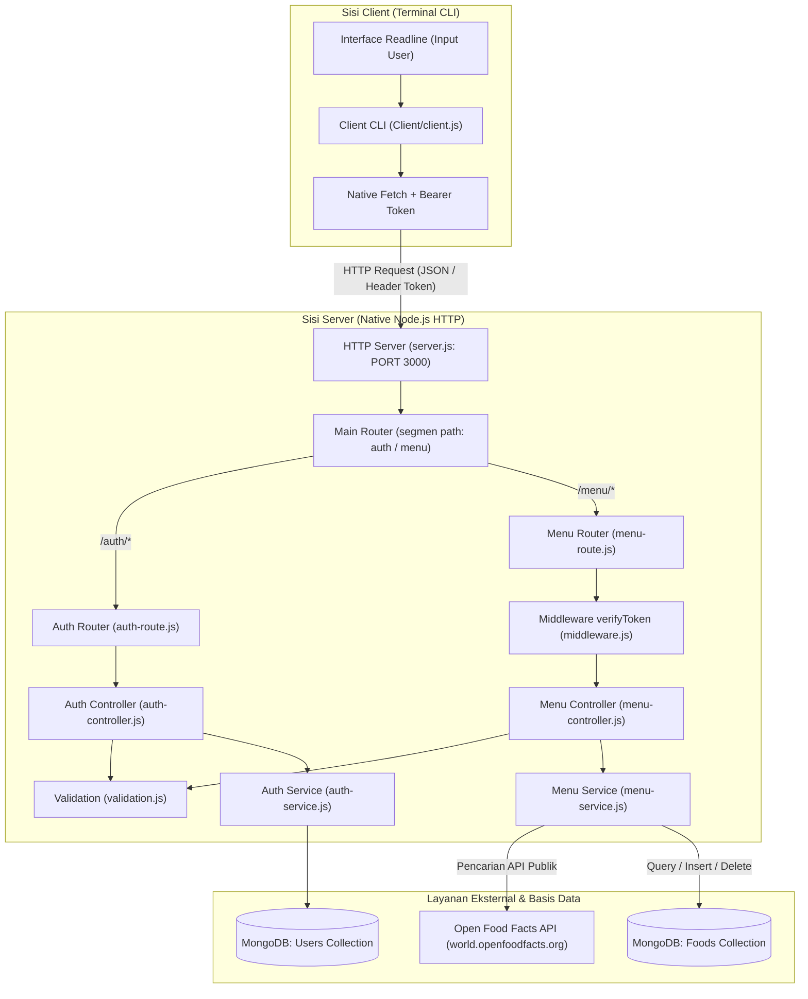

# DOKUMENTASI TEKNIS & PANDUAN PROYEK NUTRICHECK
**Aplikasi Pelacak Nutrisi & Asupan Makanan Harian (Node.js Native REST API & Interactive CLI)**

---

## DAFTAR ISI
1. [Ringkasan Eksekutif & Tech Stack](#1-ringkasan-eksekutif--tech-stack)
2. [Arsitektur Sistem & Alur Kerja Menyeluruh (End-to-End Workflow)](#2-arsitektur-sistem--alur-kerja-menyeluruh-end-to-end-workflow)
3. [Struktur Folder & Penjelasan Detail Tiap File](#3-struktur-folder--penjelasan-detail-tiap-file)
4. [Bagian-Bagian Penting yang Harus Diperhatikan & Alasannya](#4-bagian-bagian-penting-yang-harus-diperhatikan--alasannya)
5. [Pembagian Tugas Presentasi Kelompok (5 Orang)](#5-pembagian-tugas-presentasi-kelompok-5-orang)
6. [Analisis Kekurangan, Validasi Logika & Rekomendasi Solusi](#6-analisis-kekurangan-validasi-logika--rekomendasi-solusi)

---

## 1. Ringkasan Eksekutif & Tech Stack

### 1.1 Deskripsi Proyek
**NutriCheck** adalah sistem aplikasi pelacak asupan nutrisi makanan harian berbasis arsitektur **Client-Server**. Aplikasi ini memungkinkan pengguna untuk membuat akun, melakukan autentikasi, mencari data kandungan nutrisi makanan (melalui API publik *Open Food Facts*), mencatat makanan yang dikonsumsi, melihat riwayat konsumsi berdasarkan tanggal, melihat total kalkulasi gizi (kalori, protein, lemak, karbohidrat), serta mengelola/menghapus riwayat konsumsi makanan.

### 1.2 Tech Stack & Dependensi
* **Runtime Environment:** Node.js (v18+)
* **Server Framework:** **Tanpa Framework / Pure Native Node.js** (`http.createServer`). *Ini poin penting: tidak memakai Express.js.*
* **Client Interface:** Terminal CLI Interaktif menggunakan modul native `readline` dan native `fetch`.
* **Database:** MongoDB Atlas (NoSQL) menggunakan official driver `mongodb` (^7.7.0).
* **Autentikasi & Keamanan:** JSON Web Token (`jsonwebtoken` ^9.0.3).
* **Konfigurasi Environment:** `dotenv` (^18.0.9).
* **API Pihak Ketiga:** Open Food Facts API (`https://world.openfoodfacts.org/cgi/search.pl`) untuk pencarian katalog makanan global.

---

## 2. Arsitektur Sistem & Alur Kerja Menyeluruh (End-to-End Workflow)

### 2.1 Diagram Arsitektur & Alur Data



### 2.2 Penjelasan Alur Kerja Fitur

#### A. Alur Registrasi & Login (Autentikasi)
1. **Registrasi (`POST /auth/register`):**
   - User memasukkan `username` dan `password` di CLI.
   - Client mengirimkan POST request ke `/auth/register` berisi body JSON.
   - `server.js` meneruskan request ke `auth-route.js` -> `auth-controller.js`.
   - Controller membaca chunk body (`bacaBody`), memvalidasi panjang string melalui `InputanRegister` (username min. 3 karakter, password min. 8 karakter).
   - `auth-service.js` mengecek apakah username sudah ada di koleksi `Users`. Jika belum, akun baru disimpan.
   - Response `201 Created` dikirim ke client.

2. **Login (`POST /auth/login`):**
   - User menginput username dan password.
   - Request divalidasi oleh `InputanLogin`.
   - `auth-service.js` mencari user di MongoDB dan membandingkan password.
   - Jika cocok, `createToken(user)` di `Utils/token.js` membuat JWT dengan masa berlaku 24 jam.
   - Token dikembalikan ke client (`200 OK`) dan disimpan di variabel memori `tokenDiterima` pada `client.js`.
   - Setiap request ke endpoint private selanjutnya akan otomatis menyertakan header: `Authorization: Bearer <tokenDiterima>`.

#### B. Alur Menu 1: Pencarian Makanan (`GET /menu/search?q=:keyword`)
1. User memasukkan kata kunci pencarian (misal: "susu", "indomie").
2. Client mengirim GET request dengan query parameter `q`.
3. `menu-controller.js` memvalidasi panjang kata kunci (2–100 karakter).
4. `menu-service.js` pertama-tama memanggil **Open Food Facts API** eksternal menggunakan `fetch` dengan batas waktu timeout 10 detik.
5. Jika API eksternal merespons, produk dipetakan ke format lokal (kalori, protein, lemak, karbohidrat per 100g) dan disimpan/di-upsert ke MongoDB menggunakan barcode produk.
6. Jika API eksternal gagal atau kosong (*fallback*), server melakukan pencarian teks berbasis *regex case-insensitive* langsung ke koleksi lokal MongoDB.
7. Hasil pencarian ditampilkan ke user di terminal. User dapat langsung memilih nomor item untuk dicatat porsinya ke riwayat konsumsi.

#### C. Alur Menu 2: Catat Makanan Manual (`POST /menu/manual`)
1. User memasukkan nama makanan, porsi (gram), kalori (kkal), protein (g), lemak (g), dan karbohidrat (g).
2. `menu-controller.js` memvalidasi input via `InputanAddFood`.
3. Controller mengekstrak identitas user dari token (`extractUser`).
4. `menu-service.js` menyimpan data makanan beserta `userId`, `username`, dan timestamp `createdAt: new Date()` ke koleksi MongoDB.

#### D. Alur Menu 3: Riwayat Konsumsi Makanan (`GET /menu/history?date=YYYY-MM-DD` atau `?all=true`)
1. Request diperiksa oleh `verifyToken`. Jika token tidak ada atau kedaluwarsa, dikembalikan status `401 Unauthorized`.
2. Parameter tanggal diparsing. Jika kosong, default ke tanggal hari ini; jika opsi `all=true`, semua tanggal diambil.
3. Server memfilter data dengan rentang waktu awal hari (`00:00:00`) hingga akhir hari (`23:59:59.999`) yang sesuai dengan `userId` login.
4. Daftar riwayat makanan dikirimkan dan diformat rapi di terminal client.

#### E. Alur Menu 4: Ringkasan Nutrisi Harian (`GET /menu/summary?date=YYYY-MM-DD`)
1. Request diverifikasi via JWT token.
2. Server mengambil seluruh riwayat makanan pada tanggal target milik user tersebut melalui fungsi `getFoodHistory`.
3. Server melakukan looping akumulasi nilai:
   $$\text{Total Kalori} = \sum \text{kalori}, \quad \text{Total Protein} = \sum \text{protein}, \quad \text{Total Lemak} = \sum \text{lemak}, \quad \text{Total Karbo} = \sum \text{karbo}$$
4. Hasil total dikembalikan dalam bentuk objek ringkasan dan ditampilkan di layar.

#### F. Alur Menu 5: Hapus Riwayat Makanan (`DELETE /menu/history/:id` atau `DELETE /menu/history`)
1. Opsi 1 (Hapus per ID): Mengirim `DELETE /menu/history/:id`. Server memvalidasi kecocokan `ObjectId` MongoDB serta memastikan dokumen tersebut milik user yang sedang login.
2. Opsi 2 (Hapus Seluruh Riwayat): Mengirim `DELETE /menu/history`. Server menjalankan `deleteMany` hanya untuk dokumen dengan `userId` milik user yang sedang aktif.

---

## 3. Struktur Folder & Penjelasan Detail Tiap File

Berikut adalah struktur pohon direktori proyek:

```
Project Based 1/
├── package.json
├── package-lock.json
├── .gitignore
├── Client/
│   └── client.js
└── Servernya/
    ├── server.js
    ├── Config/
    │   └── db.js
    ├── Controller/
    │   ├── auth-controller.js
    │   └── menu-controller.js
    ├── Middleware/
    │   └── middleware.js
    ├── Route/
    │   ├── auth-route.js
    │   └── menu-route.js
    ├── Service/
    │   ├── auth-service.js
    │   └── menu-service.js
    ├── Utils/
    │   ├── menu.js
    │   └── token.js
    ├── Validation/
    │   └── validation.js
    └── Untitled-1.js (Draft sisa/eksperimental)
```

---

### 3.1 Penjelasan File per File

#### 1. `package.json`
* **Fungsi:** Manifest proyek Node.js yang mendefinisikan informasi proyek, skrip eksekusi, serta dependensi pustaka pihak ketiga.
* **Dependensi yang digunakan:**
  * `dotenv`: Membaca variabel environment dari file `.env`.
  * `jsonwebtoken`: Membuat dan memverifikasi token JWT.
  * `mongodb`: Driver resmi penghubung Node.js ke database MongoDB Atlas.

---

#### 2. `Client/client.js`
* **Fungsi:** Aplikasi antarmuka pengguna berbasis terminal (CLI). Bertindak sebagai klien HTTP yang berinteraksi langsung dengan REST API Server.
* **Fungsi & Bagian Penting di Dalamnya:**
  * `rl = readline.createInterface(...)`: Inisialisasi input-output terminal.
  * `question(query)`: Wrapper fungsi `rl.question` menjadi Promise agar dapat digunakan secara asinkron (`await question(...)`).
  * `requestAPI(endpoint, options)`: Fungsi pembungkus (wrapper) HTTP fetch terpusat. Secara otomatis menyuntikkan header `Authorization: Bearer <tokenDiterima>` jika user telah login.
  * `showAuthMenu()`: Menu awal sebelum login (Login, Register, Exit).
  * `handleRegister()`: Mengumpulkan username/password, menembak endpoint `/auth/register`.
  * `handleLogin()`: Mengirim kredensial ke `/auth/login`, menerima dan menyimpan JWT token ke variabel `tokenDiterima`.
  * `showMainMenu()`: Menu navigasi utama setelah autentikasi (pencarian, input, riwayat, summary, delete, logout).
  * `searchFood()`: Menembak `/menu/search?q=...`, menampilkan hasil pencarian gizi per 100g, dan menyediakan interaksi langsung untuk memasukkan makanan terpilih ke riwayat konsumsi harian.
  * `AddFood()`: Menembak `/menu/manual` dengan input form gizi manual.
  * `showFoodHistory()`: Menembak `/menu/history` dengan parameter tanggal atau seluruhnya.
  * `showNutritionSummary()`: Menembak `/menu/summary` untuk menampilkan total akumulasi nutrisi harian.
  * `deleteFoodHistory()`: Menghapus satu entri riwayat berdasarkan ID atau membersihkan seluruh riwayat user.

---

#### 3. `Servernya/server.js`
* **Fungsi:** Titik masuk utama (*entry point*) server aplikasi backend. Bertanggung jawab menghubungkan database, membuat instance HTTP Server native, dan melakukan *dispatching* rute permintaan (*routing entry*).
* **Fungsi & Bagian Penting di Dalamnya:**
  * `connectToDb(cb)`: Memastikan koneksi ke MongoDB Atlas berhasil sebelum server mulai mendengarkan (*listening*) koneksi HTTP pada PORT 3000.
  * `mainRouter(req, res)`: Memecah URL request menjadi segmen (`url.pathname.split('/').filter(Boolean)`). Jika `segmen[0] === 'auth'`, diteruskan ke `authRouter`; jika `segmen[0] === 'menu'`, diteruskan ke `menuRouter`. Jika tidak cocok, mengirimkan error 404.
  * `http.createServer(async (req, res))`: Menangani setiap request masuk dengan *try-catch* global untuk mencegah server *crash* jika terjadi exception tak terduga (mengembalikan error 500).

---

#### 4. `Servernya/Config/db.js`
* **Fungsi:** Mengelola konfigurasi dan koneksi ke database MongoDB Atlas menggunakan pola *Singleton Connection*.
* **Fungsi & Bagian Penting di Dalamnya:**
  * `usernameDB`, `passwordDB`, `namaDB`: Mengambil kredensial koneksi dari `.env`.
  * `uri`: Connection string MongoDB Atlas dengan format SRV.
  * `connectToDb(cb)`: Memanggil `MongoClient.connect(uri)` dan menyimpan instance database ke variabel `dbConnection`.
  * `getDb()`: Mengembalikan objek koneksi database yang sedang aktif ke seluruh Service layer yang membutuhkan.

---

#### 5. `Servernya/Route/auth-route.js`
* **Fungsi:** Router khusus modul autentikasi. Menentukan mapping HTTP Method dan URL endpoint otentikasi.
* **Fungsi & Bagian Penting di Dalamnya:**
  * `authRouter(req, res, segmen)`:
    * `/auth/register` (hanya menerima `POST`): Diteruskan ke `authController.register`.
    * `/auth/login` (hanya menerima `POST`): Diteruskan ke `authController.login`.
    * Memvalidasi HTTP method: Jika bukan POST, mengembalikan HTTP `405 Method Not Allowed` beserta header `Allow: POST`.

---

#### 6. `Servernya/Route/menu-route.js`
* **Fungsi:** Router khusus modul menu & pelacakan nutrisi.
* **Fungsi & Bagian Penting di Dalamnya:**
  * `menuRouter(req, res, segmen)`:
    * `/menu/search` (`GET`): Mengarah ke `menuController.searchFoods`.
    * `/menu/manual` (`POST`): Mengarah ke `menuController.FoodAdd`.
    * `/menu/history` (`GET` & `DELETE`): Mengarah ke `menuController.getFoodHistory` dan `menuController.deleteFoodHistory`. Menerima sub-segmen ID seperti `/menu/history/:id`.
    * `/menu/summary` (`GET`): Mengarah ke `menuController.getNutritionSummary`.
    * Mengembalikan status 405 jika method HTTP tidak sesuai dengan yang diizinkan pada masing-masing endpoint.

---

#### 7. `Servernya/Controller/auth-controller.js`
* **Fungsi:** Controller yang menangani parsing request masuk, memanggil validasi input, memanggil service autentikasi, dan menyusun HTTP status code serta payload response untuk modul auth.
* **Fungsi & Bagian Penting di Dalamnya:**
  * `register(req, res)`:
    1. Membaca stream body menggunakan `bacaBody(req)`.
    2. Menjalankan fungsi validasi `InputanRegister(input)`.
    3. Memanggil `authService.registerUser(username, password)`.
    4. Mengembalikan respons JSON dengan status code `201 Created`.
  * `login(req, res)`:
    1. Membaca stream body request.
    2. Menjalankan fungsi validasi `InputanLogin(input)`.
    3. Memanggil `authService.loginUser(username, password)`.
    4. Menghasilkan JWT token melalui `createToken(user)`.
    5. Mengembalikan JSON status code `200 OK` dengan token autentikasi.

---

#### 8. `Servernya/Controller/menu-controller.js`
* **Fungsi:** Controller modul nutrisi yang menjembatani data HTTP request dari client ke logic bisnis di `menu-service.js`.
* **Fungsi & Bagian Penting di Dalamnya:**
  * `searchFoods(req, res)`: Mengambil query `q`, memvalidasi panjangnya (2-100 karakter), memanggil `foodService.searchFoods(keyword)`.
  * `FoodAdd(req, res)`: Membaca body request, menjalankan `InputanAddFood`, mengekstrak data user dari header Authorization via `extractUser(req)`, lalu memanggil `foodService.AddFood`.
  * `getFoodHistory(req, res)`: Melindungi endpoint dengan `verifyToken(req, res)`. Mengambil query `date` dan `all`, memanggil service, lalu merespons dengan data riwayat.
  * `getNutritionSummary(req, res)`: Melindungi endpoint dengan `verifyToken`, mengambil query `date`, memanggil service untuk mengembalikan kalkulasi total gizi.
  * `deleteFoodHistory(req, res, idFromParam)`: Melindungi endpoint dengan `verifyToken`, mendeteksi apakah penghapusan spesifik per ID atau penghapusan seluruh data user, lalu memanggil service.

---

#### 9. `Servernya/Service/auth-service.js`
* **Fungsi:** Menyimpan business logic murni terkait autentikasi dan interaksi langsung dengan koleksi `Users` di MongoDB.
* **Fungsi & Bagian Penting di Dalamnya:**
  * `getUsersCollection()`: Mengambil referensi koleksi `Users`.
  * `registerUser(username, password)`: Memeriksa apakah username sudah terdaftar via `findOne({ username })`. Jika sudah ada, melemparkan custom error 400. Jika belum ada, menyisipkan dokumen baru `{ username, password, createdAt: new Date() }`.
  * `loginUser(username, password)`: Mencari akun berdasarkan username. Jika tidak ditemukan atau password tidak cocok, melemparkan custom error `401 Unauthorized`.

---

#### 10. `Servernya/Service/menu-service.js`
* **Fungsi:** Inti logika bisnis (*core business logic*) aplikasi NutriCheck yang menangani katalog makanan, integrasi API eksternal Open Food Facts, logging konsumsi, kalkulasi nutrisi, dan operasi CRUD riwayat.
* **Fungsi & Bagian Penting di Dalamnya:**
  * `searchFoods(keyword)`:
    * Melakukan HTTP request ke `https://world.openfoodfacts.org/cgi/search.pl`.
    * Memetakan data nutrisi per 100 gram (`energy-kcal_100g`, `proteins_100g`, `fat_100g`, `carbohydrates_100g`).
    * Menyimpan / meng-upsert hasil ke MongoDB berdasarkan barcode agar tersimpan sebagai cache.
    * Jika pemanggilan API eksternal gagal (*network error / timeout*), melakukan *fallback query* ke koleksi lokal menggunakan `$regex`.
  * `AddFood(input, user)`: Menyimpan riwayat makanan yang dimakan user ke database dengan atribut `portion`, `calories`, `protein`, `fat`, `carbs`, `userId`, `username`, dan `createdAt`.
  * `getFoodHistory(user, options)`: Mengambil data riwayat makanan dengan filter user (`userId` / `username`) dan rentang tanggal ISO (`$gte: startOfDay, $lte: endOfDay`).
  * `getNutritionSummary(user, dateStr)`: Memanggil `getFoodHistory`, lalu melakukan kalkulasi matematis *summation* untuk kalori, protein, lemak, dan karbohidrat yang dibulatkan hingga 1 angka di belakang koma.
  * `deleteFoodHistory(user, foodId)`: Menghapus satu makanan berdasarkan `_id` (`ObjectId`) atau menghapus seluruh riwayat milik user (`deleteMany`).

---

#### 11. `Servernya/Middleware/middleware.js`
* **Fungsi:** Menyediakan fungsi pencegat (*interceptor*) untuk memverifikasi keabsahan JWT token pada request yang membutuhkan proteksi akses.
* **Fungsi & Bagian Penting di Dalamnya:**
  * `verifyToken(req, res, next)`: Memeriksa keberadaan header `Authorization: Bearer <token>`. Jika valid, menyuntikkan payload user ke `req.user` dan mengembalikan nilai `true`. Jika tidak ada atau token tidak valid/kedaluwarsa, mengirim respons error `401 Unauthorized` dan mengembalikan `false`.
  * `extractUser(req)`: Versi fleksibel tanpa memblokir request. Digunakan untuk rute opsional: mengekstrak identitas user jika token tersedia, atau mengembalikan `null` jika tidak ada token.

---

#### 12. `Servernya/Utils/token.js`
* **Fungsi:** Modul utilitas pembuatan dan verifikasi JSON Web Token (JWT).
* **Fungsi & Bagian Penting di Dalamnya:**
  * `createToken(user)`: Mengenkapsulasi data user (`id` dan `username`) ke dalam payload JWT dan menandatanganinya dengan `SECRET_KEY` dengan masa kedaluwarsa 24 jam (`{ expiresIn: '24h' }`).
  * `verifyToken(token)`: Memvalidasi tanda tangan kriptografi token menggunakan `jwt.verify`.

---

#### 13. `Servernya/Utils/menu.js`
* **Fungsi:** Utilitas pembantu untuk penanganan I/O HTTP pada Native Node.js (sebagai pengganti middleware Express seperti `express.json()`).
* **Fungsi & Bagian Penting di Dalamnya:**
  * `buatError(statusCode, pesan)`: Factory function untuk menginstansiasi objek `Error` dengan atribut `statusCode`.
  * `kirimJSON(res, statusCode, data)`: Mengirimkan response dengan header `Content-Type: application/json; charset=utf-8` dan menghitung `Content-Length` otomatis.
  * `kirimError(res, statusCode, pesan)`: Standarisasi format error JSON: `{ error: pesan }`.
  * `bacaBody(req)`: Mengumpulkan chunk data stream request (`req.on('data')` dan `req.on('end')`), lalu melakukan `JSON.parse` asinkron.

---

#### 14. `Servernya/Validation/validation.js`
* **Fungsi:** Lapisan validasi integritas data masukan (*input sanitization & validation*) sebelum diproses oleh layer service.
* **Fungsi & Bagian Penting di Dalamnya:**
  * `InputanRegister(input)`: Memastikan `username` dan `password` ada, panjang `username >= 3`, dan panjang `password >= 8`.
  * `InputanLogin(input)`: Memastikan kelengkapan data login dan panjang karakter minimum.
  * `InputanAddFood(input)`: Memastikan nama makanan minimal 3 karakter serta nilai porsi, kalori, protein, lemak, dan karbohidrat bernilai numerik valid.

---

#### 15. `Servernya/Untitled-1.js`
* **Status File:** File sisa/draft eksperimen pengembangan awal.
* **Catatan:** File ini berisi prototipe gabungan server lama dan Open Food Facts search dalam satu file. Tidak digunakan dalam alur produksi aplikasi saat ini dan dapat dihapus atau diarsipkan agar tidak membingungkan tim.

---

## 4. Bagian-Bagian Penting yang Harus Diperhatikan & Alasannya

Berikut adalah 5 komponen arsitektural paling krusial yang wajib dipahami secara mendalam oleh setiap anggota kelompok:

### 1. Arsitektur Native HTTP Server (Tanpa Express)
* **Mengapa Harus Diperhatikan?**
  Hampir 90% proyek Node.js mahasiswa menggunakan Express.js di mana routing (`app.get`, `app.post`) dan body parser (`express.json()`) sudah disediakan otomatis. Pada proyek ini, tim mengimplementasikan **server HTTP murni** menggunakan modul `http` bawaan Node.js.
* **Konsep Kunci yang Harus Dipahami:**
  * Cara membaca body HTTP secara manual melalui event stream: `req.on('data', chunk => ...)` dan `req.on('end', () => ...)`.
  * Cara parsing rute secara manual: `const url = new URL(req.url, ...)` dan memecah URL path menjadi array segmen (`segmen[0]`, `segmen[1]`).
  * Penanganan header `res.writeHead(...)` dan pengiriman respon `res.end(...)`.
  * *Pertanyaan Dosen yang Sering Muncul:* "Bagaimana cara server membaca payload POST jika tidak menggunakan body-parser / Express?" -> Jawabannya ada pada fungsi `bacaBody` di [Utils/menu.js](file:///home/zufar_12/Project%20Based%201%20/Servernya/Utils/menu.js#L28-L44).

---

### 2. Mekanisme Keamanan & Autentikasi Stateless Berbasis JWT
* **Mengapa Harus Diperhatikan?**
  Aplikasi ini menggunakan sistem autentikasi modern tanpa session di database server (*stateless*).
* **Konsep Kunci yang Harus Dipahami:**
  * Saat login sukses, server menandatangani (*signing*) token JWT menggunakan secret key yang berisi identitas user (`id`, `username`).
  * Klien menyimpan token tersebut di memori terminal CLI (`client.js`).
  * Pada setiap request berikutnya, token dikirim melalui Header standar HTTP: `Authorization: Bearer <token>`.
  * Server mencegat request di file `middleware.js` menggunakan fungsi `jwt.verify(token, SECRET_KEY)`. Jika token valid, identitas didekodekan dan ditempelkan ke objek `req.user`.

---

### 3. Pemisahan Tanggung Jawab (*Separation of Concerns / Layered Architecture*)
* **Mengapa Harus Diperhatikan?**
  Struktur kode backend sengaja dipecah menjadi beberapa lapisan agar kode modular, mudah diuji, dan rapi:
  1. **Route Layer:** Hanya memeriksa HTTP Method (GET/POST/DELETE) dan path endpoint.
  2. **Controller Layer:** Bertanggung jawab atas HTTP level (membaca parameter, memanggil validasi input, menentukan HTTP status code 200/201/400/404/500).
  3. **Service Layer:** Menampung logika bisnis murni (*business rules*) dan berkomunikasi langsung dengan MongoDB.
  4. **Config & Utils Layer:** Menyediakan helper yang independen.

---

### 4. Integrasi External API dengan Mekanisme Caching & Fallback
* **Mengapa Harus Diperhatikan?**
  Fitur pencarian makanan tidak hanya bergantung pada database lokal, tetapi mengintegrasikan API pihak ketiga berskala global (*Open Food Facts*).
* **Konsep Kunci yang Harus Dipahami:**
  * Penggunaan `AbortSignal.timeout(10000)` untuk mencegah server menggantung (*hanging*) jika jaringan lambat.
  * Mekanisme **Caching Database**: Setiap produk dari Open Food Facts langsung disimpan/diperbarui ke koleksi MongoDB menggunakan operasi `updateOne` dengan opsi `{ upsert: true }` berdasarkan barcode produk.
  * Mekanisme **Fallback**: Jika Open Food Facts down atau tidak menemukan data, server otomatis beralih mencari data yang sudah tersimpan di MongoDB lokal menggunakan `$regex`.

---

### 5. Manipulasi Rentang Waktu (Date Boundaries) & Kalkulasi Gizi
* **Mengapa Harus Diperhatikan?**
  Fitur riwayat makanan dan ringkasan nutrisi harian bergantung pada ketepatan filter tanggal.
* **Konsep Kunci yang Harus Dipahami:**
  * Format tanggal standar yang digunakan adalah `YYYY-MM-DD` (ISO 8601).
  * Pembuatan batas awal hari (`T00:00:00`) dan batas akhir hari (`T23:59:59.999`) untuk query MongoDB `$gte` dan `$lte`.
  * Kalkulasi nutrisi menggunakan pembulatan matematis `Math.round(total * 10) / 10` untuk mencegah masalah floating-point desimal pada JavaScript (misal `0.1 + 0.2 = 0.30000000000000004`).

---

## 5. Pembagian Tugas Presentasi Kelompok (5 Orang)

Berikut adalah pembagian peran dan materi presentasi yang seimbang untuk 5 anggota kelompok:

---

### 👤 Anggota 1: System Architect & Server Entry Point
* **Peran:** Pembuka Presentasi, Penjelas Latar Belakang & Infrastruktur Server.
* **File yang Dikuasai:**
  * `Servernya/server.js`
  * `Servernya/Config/db.js`
  * `package.json`
* **Materi yang Dijelaskan:**
  1. Latar belakang proyek NutriCheck, use case aplikasi, dan pemilihan arsitektur Client-Server.
  2. Mengapa memilih Native Node.js HTTP (`http.createServer`) dibandingkan Express.js.
  3. Alur inisialisasi server: koneksi ke database MongoDB Atlas terlebih dahulu via `connectToDb` sebelum server melakukan `server.listen`.
  4. Cara kerja `mainRouter` dalam membedah segmen URL (`/auth` vs `/menu`) dan penanganan error server global (*try-catch* status 500).
* **Prediksi Pertanyaan Penguji & Jawaban:**
  * *T: Mengapa koneksi database dipanggil sebelum `server.listen`?*
  * *J:* Agar server tidak menerima traffic sebelum koneksi database siap. Jika database belum terhubung dan ada request masuk, query akan crash (*race condition*).

---

### 👤 Anggota 2: Security & Authentication Specialist
* **Peran:** Penjelas Sistem Keamanan, Alur Autentikasi & Manajemen Token.
* **File yang Dikuasai:**
  * `Servernya/Route/auth-route.js`
  * `Servernya/Controller/auth-controller.js`
  * `Servernya/Service/auth-service.js`
  * `Servernya/Utils/token.js`
  * `Servernya/Middleware/middleware.js`
* **Materi yang Dijelaskan:**
  1. Alur lengkap pendaftaran user baru (`POST /auth/register`) dan pengecekan duplikasi username di koleksi `Users`.
  2. Alur login user (`POST /auth/login`) dan pembuatan JSON Web Token (JWT) dengan masa kedaluwarsa 24 jam.
  3. Cara kerja fungsi `verifyToken` di middleware untuk melindungi endpoint privat dan menyuntikkan data user ke `req.user`.
  4. Perbedaan antara `verifyToken` (memblokir request tidak sah dengan 401) dan `extractUser` (hanya membaca user jika ada tanpa memblokir).
* **Prediksi Pertanyaan Penguji & Jawaban:**
  * *T: Bagaimana cara server mengetahui user yang mengakses endpoint tanpa menyimpan session di server?*
  * *J:* Server menggunakan JWT stateless. Token yang dikirim via header Authorization diverifikasi tanda tangan kriptografinya menggunakan `SECRET_KEY`. Jika valid, server langsung mengetahui `userId` dan `username` dari payload token tanpa query database session.

---

### 👤 Anggota 3: External API & Food Search Engineer
* **Peran:** Penjelas Modul Pencarian Makanan & Integrasi Open Food Facts.
* **File yang Dikuasai:**
  * `Servernya/Route/menu-route.js` (khusus endpoint `/menu/search`)
  * `Servernya/Controller/menu-controller.js` (fungsi `searchFoods`)
  * `Servernya/Service/menu-service.js` (fungsi `searchFoods`)
* **Materi yang Dijelaskan:**
  1. Cara kerja endpoint `GET /menu/search?q=:keyword` dan validasi panjang keyword (2–100 karakter).
  2. Integrasi ke Open Food Facts API menggunakan native `fetch` dengan parameter `search_simple`, `fields`, dan timeout 10 detik via `AbortSignal.timeout(10000)`.
  3. Normalisasi data nutrisi per 100g (kalori, protein, lemak, karbohidrat).
  4. Mekanisme caching cerdas: menyimpan hasil pencarian ke database MongoDB menggunakan barcode produk dengan opsi `upsert: true`.
  5. Mekanisme fallback: melakukan pencarian regex pada database lokal jika API eksternal sedang down atau tidak ada jaringan.
* **Prediksi Pertanyaan Penguji & Jawaban:**
  * *T: Apa yang terjadi jika API Open Food Facts mati atau koneksi internet lambat?*
  * *J:* Server diproteksi oleh timeout 10 detik agar request tidak hanging. Jika gagal, error ditangkap di blok *catch* dan sistem otomatis beralih (*fallback*) mencari data yang pernah tersimpan di database lokal menggunakan `$regex`.

---

### 👤 Anggota 4: Nutrition Calculation & Data Tracking Specialist
* **Peran:** Penjelas Logika Riwayat Makanan, Kalkulasi Gizi & Operasi CRUD.
* **File yang Dikuasai:**
  * `Servernya/Route/menu-route.js` (endpoint `/manual`, `/history`, `/summary`)
  * `Servernya/Controller/menu-controller.js` (`FoodAdd`, `getFoodHistory`, `getNutritionSummary`, `deleteFoodHistory`)
  * `Servernya/Service/menu-service.js` (`AddFood`, `getFoodHistory`, `getNutritionSummary`, `deleteFoodHistory`)
* **Materi yang Dijelaskan:**
  1. Pencatatan makanan manual (`POST /menu/manual`) dan penyimpanan porsi serta nutrisi berdasarkan `userId`.
  2. Filter riwayat konsumsi berdasarkan tanggal tertentu dengan membatasi rentang waktu hari tersebut (`startOfDay` dan `endOfDay`).
  3. Algoritma akumulasi / ringkasan nutrisi harian (penjumlahan total kalori, protein, lemak, dan karbohidrat).
  4. Fitur penghapusan riwayat: penghapusan spesifik berdasarkan `ObjectId` atau penghapusan seluruh data konsumsi milik user yang sedang aktif.
* **Prediksi Pertanyaan Penguji & Jawaban:**
  * *T: Bagaimana cara memastikan user A tidak bisa menghapus riwayat makanan milik user B?*
  * *J:* Pada fungsi `deleteFoodHistory`, filter query MongoDB menyertakan `_id: new ObjectId(foodId)` dan kepemilikan user `{ userId: user.id }`. Jika ID makanan ditemukan tapi `userId` tidak cocok, database tidak menghapus data dan server melempar error 404/403.

---

### 👤 Anggota 5: Client Interface, Utility, Validation & Quality Analyst
* **Peran:** Penjelas Aplikasi Klien Terminal, Validasi Data, Utilitas I/O, serta Analisis Evaluasi Sistem.
* **File yang Dikuasai:**
  * `Client/client.js`
  * `Servernya/Validation/validation.js`
  * `Servernya/Utils/menu.js`
* **Materi yang Dijelaskan:**
  1. Arsitektur aplikasi CLI pada `client.js`: navigasi menu berbasis readline, promise wrapper `question()`, dan fungsi `requestAPI()`.
  2. Alur validasi data di `validation.js` (aturan panjang username/password, validasi numerik nutrisi makanan).
  3. Cara kerja fungsi helper di `Utils/menu.js`: `bacaBody` (asynchronous body parser), `kirimJSON`, dan `kirimError`.
  4. Menyampaikan **Analisis Kekurangan dan Rekomendasi Peningkatan** proyek NutriCheck (menjelaskan temuan bug, celah keamanan, dan rencana perbaikan masa depan seperti hashing password dan pemisahan koleksi).
* **Prediksi Pertanyaan Penguji & Jawaban:**
  * *T: Apa kekurangan terbesar pada sistem ini dan bagaimana cara memperbaikinya?*
  * *J:* Password saat ini masih disimpan dalam bentuk teks biasa (plaintext) di database. Rekomendasi perbaikannya adalah menggunakan library hashing seperti `bcrypt` dengan salt rounds minimal 10 sebelum disimpan ke database.

---

## 6. Analisis Kekurangan, Validasi Logika & Rekomendasi Solusi

Berdasarkan tinjauan kode mendalam (*deep code review*), berikut adalah temuan kekurangan, bug validasi logika, celah keamanan, dan rekomendasi perbaikannya:

---

### 🔴 1. Celah Keamanan Fatal: Password Disimpan dalam Bentuk Plaintext
* **Lokasi Kode:** [Servernya/Service/auth-service.js](file:///home/zufar_12/Project%20Based%201%20/Servernya/Service/auth-service.js#L21)
  ```javascript
  const newUser = {
      username: username.trim(),
      password: password, // <-- DISIMPAN SEBAGAI TEKS POLOS TANPA HASH
      createdAt: new Date()
  };
  ```
* **Masalah & Risiko:**
  Jika database MongoDB Atlas bocor atau diakses oleh pihak yang tidak bertanggung jawab, seluruh kredensial password pengguna akan langsung terlihat.
* **Rekomendasi Solusi:**
  Gunakan library `bcrypt` atau modul bawaan Node.js `crypto.scrypt` untuk melakukan hashing password sebelum disimpan, dan gunakan `bcrypt.compare()` pada fungsi `loginUser`.

---

### 🔴 2. Masalah Desain Database (Data Pollution): Pencampuran Katalog Makanan & Log Konsumsi Pengguna [SUDAH DIPERBAIKI]
* **Lokasi Kode:** [Servernya/Service/menu-service.js](file:///home/zufar_12/Project%20Based%201%20/Servernya/Service/menu-service.js#L5-L15)
* **Masalah Awal & Risiko:**
  Koleksi `Foods` sebelumnya digunakan untuk dua tujuan sekaligus (master data Open Food Facts dan log konsumsi user). Akibatnya, ada bug di mana user baru yang belum mencatat makanan justru disuguhi produk Open Food Facts sebagai riwayat makanannya.
* **Perbaikan yang Telah Diterapkan:**
  1. Memisahkan target koleksi secara tegas:
     - `getCatalogCollection()`: Merujuk ke koleksi `Foods` khusus katalog makanan dan cache Open Food Facts.
     - `getLogsCollection()`: Merujuk ke koleksi `Food_Logs` khusus riwayat konsumsi makanan pengguna.
  2. Menghapus *legacy filter* yang bocor pada `getFoodHistory` sehingga riwayat makanan hanya menampilkan data milik user yang sedang terautentikasi.
  3. Memperbaiki fungsi `deleteFoodHistory` agar hanya menghapus data dari `Food_Logs` milik user terkait, mencegah terhapusnya data katalog.

---

### 🟡 3. Bug Validasi Logika pada Input Nilai Nutrisi (`InputanAddFood`) [SUDAH DIPERBAIKI]
* **Lokasi Kode:** [Servernya/Validation/validation.js](file:///home/zufar_12/Project%20Based%201%20/Servernya/Validation/validation.js#L27-L68)
* **Masalah Awal:**
  Pengecekan awal `!input.fat` atau `input.fat <= 0` menolak nilai `0` karena dianggap *falsy*, sehingga makanan bebas lemak (seperti putih telur) atau makanan bebas karbohidrat (seperti minyak goreng) ditolak oleh server. Selain itu, pesan validasi login tidak sinkron dengan panjang password.
* **Perbaikan yang Telah Diterapkan:**
  1. Validasi diubah agar memeriksa keberadaan field (`input[field] !== undefined && input[field] !== null && input[field] !== ''`) dan memastikan tipe data numerik valid.
  2. Mengizinkan nilai nutrisi bernilai `0` (`>= 0`) untuk kalori, protein, lemak, dan karbohidrat, serta hanya menolak jika bernilai negatif (`< 0`).
  3. Memastikan `portion > 0` dan `name.length >= 3`.
  4. Memperbaiki `InputanLogin` agar memvalidasi username minimal 3 karakter dan password minimal 8 karakter dengan pesan error yang akurat.

---

### 🟡 4. Endpoint `/menu/manual` Menggunakan `extractUser` Bukan `verifyToken` [SUDAH DIPERBAIKI]
* **Lokasi Kode:** [Servernya/Controller/menu-controller.js](file:///home/zufar_12/Project%20Based%201%20/Servernya/Controller/menu-controller.js#L38-L54)
* **Masalah Awal:**
  Endpoint pencatatan makanan `POST /menu/manual` sebelumnya menggunakan `extractUser(req)` yang tidak memblokir request tanpa token. Akibatnya, request tanpa login menghasilkan data yatim (*orphan data*) dengan `userId: null` yang tidak dapat diakses kembali oleh pengguna.
* **Perbaikan yang Telah Diterapkan:**
  1. Mengganti `extractUser(req)` dengan `if (!verifyToken(req, res)) return;` pada controller `FoodAdd`.
  2. Meneruskan data user terautentikasi `req.user` secara konsisten ke `foodService.AddFood(input, req.user)`.
  3. Menambahkan pengecekan di service layer bahwa user wajib terautentikasi untuk menyimpan riwayat.

---

### 🟡 5. Pesan Error Menyesatkan pada Validasi Login [SUDAH DIPERBAIKI]
* **Status:** Sudah disinkronkan di dalam `Servernya/Validation/validation.js` bersamaan dengan perbaikan validasi input.

---

### 🟡 6. Potensi DoS pada Body Parser (`bacaBody`) Akibat Ketiadaan Pembatasan Ukuran Payload
* **Lokasi Kode:** [Servernya/Utils/menu.js](file:///home/zufar_12/Project%20Based%201%20/Servernya/Utils/menu.js#L28-L44)
  ```javascript
  req.on('data', (chunk) => {
      body += chunk;
  });
  ```
* **Masalah:**
  Tidak ada batas maksimal ukuran stream body (*payload limit*). Jika penyerang mengirimkan file JSON berukuran sangat besar (misal 500 MB), server akan terus menampung string tersebut di RAM hingga menyebabkan *Memory Leak* atau *Out of Memory (OOM) Crash*.
* **Rekomendasi Solusi:**
  Tambahkan pembatasan ukuran chunk, misalnya maksimal 1 MB:
  ```javascript
  if (body.length > 1e6) {
      req.destroy();
      reject(buatError(413, 'Payload request terlalu besar'));
  }
  ```

---

### 🟡 7. Inisialisasi Kunci Rahasia JWT yang Kurang Aman (Fallback Default Key)
* **Lokasi Kode:** [Servernya/Middleware/middleware.js](file:///home/zufar_12/Project%20Based%201%20/Servernya/Middleware/middleware.js#L7) & [Servernya/Utils/token.js](file:///home/zufar_12/Project%20Based%201%20/Servernya/Utils/token.js#L7)
  ```javascript
  const SECRET_KEY = process.env.SECRET_KEY || 'ambatron48';
  ```
* **Masalah:**
  Jika environment variable `SECRET_KEY` tidak disetel di file `.env`, aplikasi menggunakan *hardcoded fallback secret* `'ambatron48'`. Nilai ini dapat dilihat oleh siapapun di source code publik, memungkinkan pihak luar memalsukan JWT token dan menyamar sebagai akun admin atau user lain.
* **Rekomendasi Solusi:**
  Wajibkan `SECRET_KEY` diisi pada `.env`. Jika kosong saat startup, hentikan proses server:
  ```javascript
  if (!process.env.SECRET_KEY) {
      console.error("FATAL: SECRET_KEY belum dikonfigurasi di .env!");
      process.exit(1);
  }
  ```

---

### 🟢 8. File Sisa/Draft yang Tidak Terpakai (`Untitled-1.js`)
* **Lokasi Kode:** [Servernya/Untitled-1.js](file:///home/zufar_12/Project%20Based%201%20/Servernya/Untitled-1.js)
* **Masalah:**
  File ini berisi kode awal eksperimen sebelum arsitektur MVC dipisahkan. Keberadaannya berisiko membingungkan anggota tim lain dan menurunkan skor kerapian kode (*clean code*). Sebaiknya dihapus dari repository kerja.

---

### 📊 Tabel Ringkasan Analisis Evaluasi

| No | Komponen | Masalah / Temuan | Tingkat Keparahan | Status Perbaikan | Solusi yang Diterapkan |
|---|---|---|---|---|---|
| 1 | `auth-service.js` | Password disimpan dalam teks biasa (plaintext) | 🔴 Kritis (High Risk) | ⏳ Belum Diperbaiki | Perlu hashing dengan `bcrypt` atau `crypto.scrypt`. |
| 2 | `menu-service.js` | Koleksi `Foods` mencampur master data dan riwayat konsumsi | 🔴 Kritis (Logic Bug) | ✅ **SUDAH DIPERBAIKI** | Dipisahkan: `Foods` (katalog) dan `Food_Logs` (riwayat user). Legacy filter dihapus. |
| 3 | `validation.js` | Menolak input gizi bernilai 0 (cth: makanan 0g lemak/karbo) | 🟡 Sedang (Bug Fungsional) | ✅ **SUDAH DIPERBAIKI** | Diizinkan `>= 0`, validasi numerik diperketat, pesan login disinkronkan. |
| 4 | `menu-controller.js` | Endpoint `/menu/manual` tidak mewajibkan login (`extractUser`) | 🟡 Sedang (Data Integrity) | ✅ **SUDAH DIPERBAIKI** | Diganti menggunakan `verifyToken`, data selalu terikat ke `req.user`. |
| 5 | `menu.js` | `bacaBody` tanpa pembatasan ukuran payload | 🟡 Sedang (DoS Vulnerability) | ⏳ Belum Diperbaiki | Batasi buffer maksimal (cth: 1 MB). |
| 6 | `token.js` & `middleware.js` | Fallback default secret key `'ambatron48'` | 🟡 Sedang (Security Practice) | ⏳ Belum Diperbaiki | Wajibkan via `.env` dan hapus hardcoded string. |
| 7 | `menu-service.js` | Potensi salah tanggal akibat perbedaan zona waktu server & lokal | 🟢 Rendah (Edge Case) | ⏳ Belum Diperbaiki | Sinkronkan zona waktu ISO dengan WIB/UTC client. |
| 8 | `Servernya/` | Adanya file sisa `Untitled-1.js` | 🟢 Rendah (Clean Code) | ⏳ Belum Diperbaiki | Hapus atau masukkan ke dalam `.gitignore`. |

---

*Dokumen ini disusun untuk panduan teknis internal tim dan persiapan presentasi proyek NutriCheck.*
